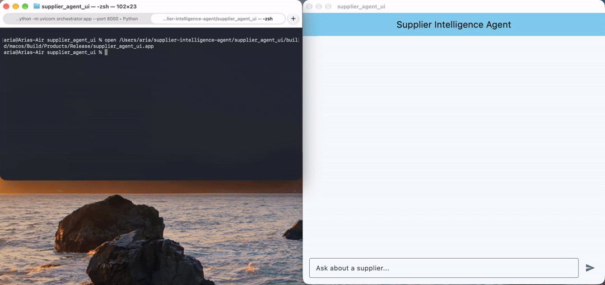

# Supplier Intelligence Agent 

A full-stack AI agent designed to retrieve and summarize supplier risk and compliance data using the Model Context Protocol (MCP).

## Architecture
* **Frontend:** Flutter / Dart (macOS Desktop App)
* **Orchestrator:** Python / FastAPI
* **LLM:** Google Gemini (via dynamic tool calling)
* **Data Layer:** SQLite & MCP (Model Context Protocol)

## How It Works
Instead of writing brittle API wrappers, this project uses the standard **Model Context Protocol (MCP)** to expose a local SQL database to an AI agent. 
1. The user asks a question via the Flutter chat UI.
2. The FastAPI orchestrator intercepts the request and dynamically translates MCP tool schemas into Google Gemini function declarations.
3. Gemini determines if it needs to query the database and triggers the `get_supplier_risk` MCP tool.
4. The backend securely executes the SQL query, returning audit dates and ESG compliance statuses back to the LLM for summarization.

## Setup & Running Locally
**1. Start the DB and MCP Server:**
`python3 mcp_server.py` (Runs silently over stdio)

**2. Start the Orchestrator:**
`export GEMINI_API_KEY="your_key"`
`uvicorn orchestrator:app --port 8000`

**3. Launch the Flutter UI:**
`flutter run -d macos`
